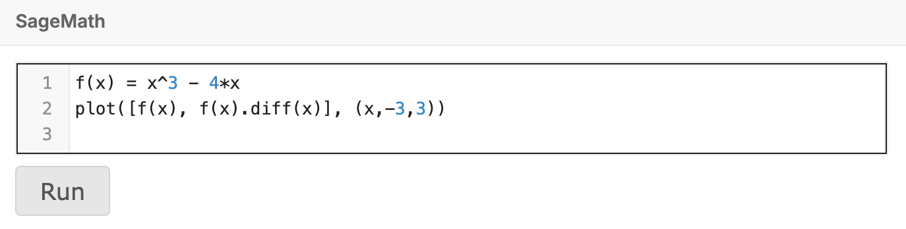
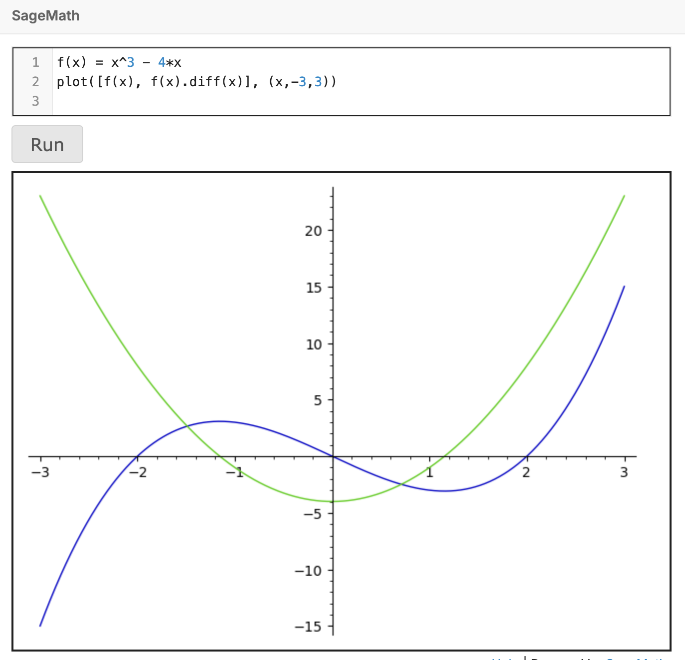

# Discourse-Sage-Math Plugin

Discourse-Sage-Math is a Discourse plugin that allows you to easily embed active [SageMath](https://www.sagemath.org/) code into a Discourse post. The code can be evaluated using the [SageCell Server API](https://sagecell.sagemath.org/).

A sage-fenced code block looks like so:

    ```sage
    f(x) = x^3 - 4*x
    plot([f(x), f(x).diff(x)], (x,-3,3))
    ```

Placing that code block into a post would yield the following in the rendered post:

<picture>
  <source media="(prefers-color-scheme: dark)" srcset="screenshots/sage-dark.png">
  <source media="(prefers-color-scheme: light)" srcset="screenshots/sage-light.png">
  
</picture>

Hitting the "Run" button should send the code to the Sage Cell server where it's evaluated; the result looks like so:

<picture>
  <source media="(prefers-color-scheme: dark)" srcset="screenshots/rendered-sage-dark.png">
  <source media="(prefers-color-scheme: light)" srcset="screenshots/rendered-sage-light.png">
  
</picture>
